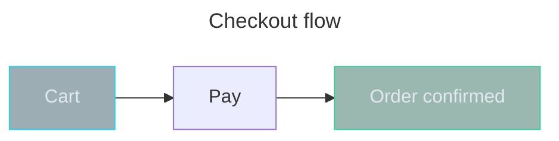

# Diagram System (Mermaid source, rendered SVG)

Every diagram is a **Mermaid fenced block** (` ```mermaid `) inline in the Markdown that owns it: masterplan section, detail doc, or ticket. That block is the source of truth: cheap to write, diffable, rendered by GitHub and most viewers, and readable as text by an executor. SVG files exist only as renders for the HTML deck (`references/html-export.md`); never edit an SVG as the master.

## Diagram per masterplan section

| Section | Mermaid type | Content |
|---|---|---|
| §5 user flows | `flowchart LR` | screens/actions as nodes, transitions as labelled edges; one block per primary flow; entry node `entry`, success end-state `ok` |
| §7 data model | `erDiagram` | every table with fields (`PK`/`FK` marked), relations with cardinality |
| §8 multi-actor or async endpoints | `sequenceDiagram` | actors as participants, calls top-to-bottom, async calls as `-)` |
| §11 architecture | `flowchart` + `subgraph` | one subgraph per boundary of what runs where (browser / host / region), components inside |
| §18 build order | `flowchart TD` | one node per milestone, edges = blocking dependencies, generated from the validated ticket catalog; independent slices visibly parallel; no cap on milestone count |

Add a diagram anywhere else a flow, state machine, or relationship reads faster than prose (`stateDiagram-v2` for lifecycles). Name a block with Mermaid frontmatter when the section has several:

````markdown

````

## Semantic color map

Flowcharts declare these as `classDef` lines; the same kind of node gets the same class in every diagram of the package. Other diagram types keep the theme defaults.

| Class | Component type | Fill | Stroke |
|---|---|---|---|
| `entry` | Frontend / entry | `#08334466` | `#22d3ee` |
| `ok` / `svc` | Success end-state / backend process | `#064e3b66` | `#34d399` |
| `db` | Database / datastore | `#4c1d9566` | `#a78bfa` |
| `cloud` | Cloud / hosting | `#78350f4d` | `#fbbf24` |
| `risk` | Security / error | `#88133766` | `#fb7185` |
| `ext` | Message bus / external | `#1e293b80` | `#94a3b8` |

Text color `#e2e8f0` on every class. Datastores use the cylinder shape `[(name)]`.

## Verification (phase-6 self-review)

1. **Syntax:** `scripts/validate-package.py` fails any Mermaid block that is unclosed, empty, or lacks a known diagram type. `scripts/render-diagrams.py` is the full parser: a block that fails to render is broken.
2. **Coverage:** every node, actor, or table the section names appears in its block; check by grepping the block for each name.
3. **Render:** open the rendered SVGs inside `masterplan.html` and confirm labels and edges are visible.

Record method + outcome in `references/decisions.md` (Phase 6 block). A diagram counts as valid only after these checks, never by eye alone.

## Rendering for the deck

Run `python3 <skill>/scripts/render-diagrams.py <package>`. It writes one SVG per block into `references/diagrams/`: masterplan blocks as `s<section>-<n>.svg`, other documents as `<path-slug>-<n>.svg`; `--dry-run` prints the mapping. It uses `mmdc` from PATH, else `npx` with a pinned mermaid-cli, and a system Chrome/Chromium when present. Exit 2 means no renderer exists in this runtime: hand-author the deck SVGs instead (below).

### Hand-authored SVG fallback

Only when the renderer is unavailable, write each deck SVG by hand at the same path, from the same block:

- `viewBox` sized to content, everything inline, no external requests.
- Background slate-950 `#020617` with a 40px grid (`stroke="#1e293b"`, `stroke-width="0.5"`); `font-family="'JetBrains Mono', monospace"`; 12px names, 9px sublabels.
- Rounded rects `rx="6"`, 1.5px stroke, colors from the map above; opaque `#0f172a` rect under each semi-transparent one so arrows never show through.
- Arrows drawn right after the grid, arrowheads via `<marker>`; dashed `4,4` for async/security, `8,4` for boundaries.
- Must parse as XML (the validator checks every `references/diagrams/*.svg`) and name every node its block names.

Record `HAND-SVG` and the reason in the Phase 6 block of `references/decisions.md`. The package is never blocked on diagram tooling.
